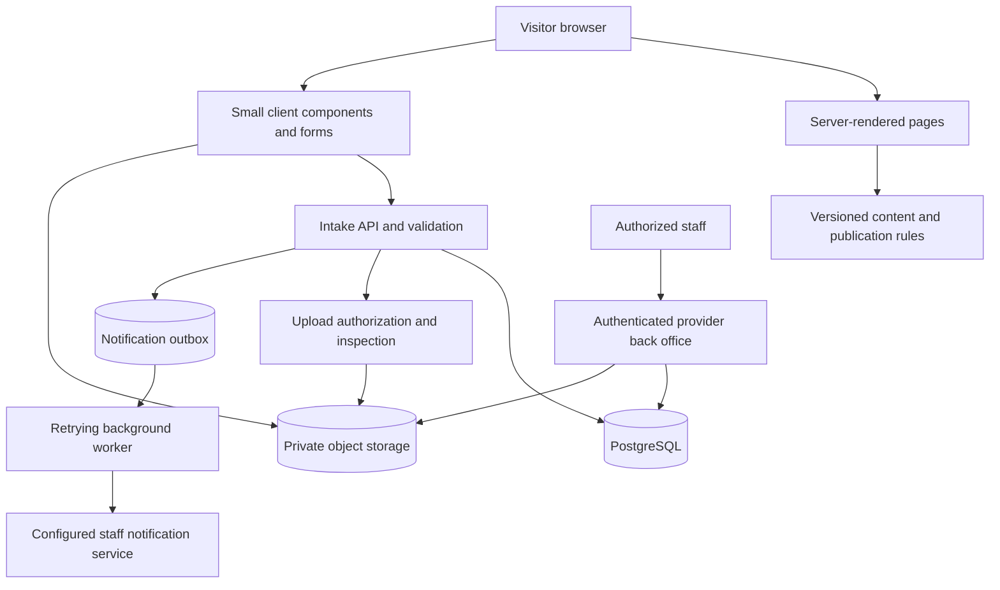

# Technical architecture

**Navigation update:** [the user's single-page instruction](15-SINGLE-PAGE-UPDATE.md) supersedes the older route presentation below. The main experience is now homepage sections; old feature URLs are compatibility redirects. Data/privacy/release requirements remain applicable.

## Architectural decision

PROPOSED baseline for a new project: Next.js App Router with TypeScript, server-rendered marketing pages, CSS Modules plus global tokens, PostgreSQL for intake records, private object storage for creator uploads, and a replaceable notification adapter. Use a small accessible component primitive library only where it helps menus/dialogs; use an established icon library rather than custom-drawing common controls.

No project stack existed when this handoff was prepared. If the coding agent discovers an existing application later, inspect and preserve it where appropriate rather than replacing it blindly. Exact versions and hosting are selected during implementation using current official documentation; commit dependency versions and a lockfile. This document does not prescribe an obsolete minor version or authorize buying hosting.

[Next.js App Router documentation](https://nextjs.org/docs/app) describes the chosen routing/rendering model. [PostgreSQL constraints](https://www.postgresql.org/docs/current/ddl-constraints.html) support persistent integrity checks. These are technical references, not additional product requirements.

## System boundaries



The public browser never connects directly to privileged database credentials. Static public media and private creator uploads use separate storage paths/access policies. Do not treat a hard-to-guess URL as private access control.

## Rendering and component boundaries

Server components render navigation, headings, service inventory, package content, testimonials, metadata, and footer. Client components handle menu state, player controls, optional scene motion, form state, and upload progress. The page should remain informative if JavaScript fails; do not hide primary content until an animation runs.

Hero motion is a bounded progressive enhancement built with CSS transforms and a small observer/controller. Start with CSS and browser APIs; add one animation library only if necessary after profiling. No reason to install overlapping animation libraries or a 3D engine for flat footage layers.

Form submission may require client JavaScript for the upload journey; if unavailable, show an explicit usable explanation rather than a spinning or misleading submit button. All validation remains enforced on the server.

## Proposed future folder layout

This is an architecture sketch; these application files are not created by the documentation phase.

```text
src/
  app/
    layout.tsx
    page.tsx
    services/page.tsx
    testimonials/page.tsx
    pricing/page.tsx
    workflow/page.tsx
    become-a-creator/page.tsx
    privacy/page.tsx
    terms/page.tsx
    api/enquiries/route.ts
    api/creator-applications/route.ts
    api/upload-sessions/route.ts
    api/uploads/authorize/route.ts
    api/uploads/[id]/complete/route.ts
    api/uploads/[id]/route.ts
  components/
    layout/  story/  media/  services/  pricing/  forms/
  content/
    services.ts  packages.ts  copy.ts  devices.ts  media.ts
  lib/
    validation/  publication/  server/  telemetry/
  styles/
    tokens.css  globals.css
  workers/
    inspect-uploads.ts  deliver-notifications.ts  expire-uploads.ts
db/migrations/
tests/
public/approved-media/
docs/
```

## Content architecture

Use typed, version-controlled content first. A CMS is not needed for v1 unless the owner requires nontechnical editing. Treat `docs/data` as planning input: transform it into application content with strict publication filters rather than copying every raw source field onto the site.

Every commercial field needs value, provenance, and publication status. Keep draft/reference values available in private preview without exposing them in HTML, JSON endpoints, metadata, or client bundles for production. Publication checks occur server-side and at build time; CSS hiding is insufficient.

The requirements document governs service coverage. The decisions register governs unresolved business facts. Creative copy belongs to an independent content module so revising a headline cannot alter package entitlements.

## Enquiry persistence

Validate request → apply rate limits → enforce idempotency → store enquiry and notification outbox item in one database transaction → return saved confirmation. Notification is asynchronous and retryable. Database failure returns an error without success messaging. Email failure after commit does not lose the enquiry.

Use database uniqueness for idempotency and foreign keys for application-upload relationships. Do not rely solely on in-process maps, local JSON files, or transient serverless memory. A local database can serve development; it must also persist across restarts.

## Upload architecture

Issue short-lived, bounded upload authorizations with server-generated keys. Store files privately and inspect completion server-side. Match the stored object length/type to the authorized request, then inspect actual content. Only ready uploads owned by the submitting session can attach to an application. Storage access is denied by default.

Staff downloads require authentication/authorization followed by a short-lived signed URL. The public API does not return storage keys, durable download links, or applicant data by ID alone. Provider dashboards are acceptable for the first release if access is configured and the owner can actually review submissions. A custom admin interface is deferred.

## Preview versus production

Private preview may render marked draft package fields and empty content blocks. Its forms use a test database/storage and test recipient or no-notification adapter. A preview adapter may return a clearly labelled demo result for visual exploration, but functional acceptance requires durable storage; production never accepts a mock-success path.

Production builds fail when an enabled required feature lacks its relevant approvals/configuration. Examples: creator intake without device rules or privacy notice; package publication with reference-only prices; testimonials page with no approved content. The build agent can complete the implementation while these owner-provided inputs remain outstanding, but must report the release blockers precisely.

## Operational configuration

Proposed environment configuration names (not actual secrets):

- `APP_ORIGIN`: real canonical site origin, supplied by owner.
- `APP_ENV`: local, preview, production.
- `DATABASE_URL`: server-only database connection.
- `OBJECT_STORAGE_ENDPOINT`, `OBJECT_STORAGE_REGION`, `OBJECT_STORAGE_BUCKET`, `OBJECT_STORAGE_ACCESS_KEY`, `OBJECT_STORAGE_SECRET_KEY`: server-only private storage adapter configuration.
- `PUBLIC_MEDIA_BASE_URL`: only for approved public assets, not applications.
- `SESSION_SECRET`: server-only signing material for anonymous upload sessions.
- `NOTIFICATION_PROVIDER`, `NOTIFICATION_API_KEY`, `STAFF_NOTIFICATION_RECIPIENT`: configured operator-approved destination.
- `WORKER_SECRET`: authentication for background work if invoked over HTTP.
- `BUSINESS_TIMEZONE`: proposed `Asia/Kolkata`.

Provider-specific adjustments are allowed, documented, and tested. No secret belongs in public environment variables or committed example values. Validate required production configuration at startup/build and expose a non-sensitive readiness signal for operations.

## Deployment and maintenance

Use separate preview and production resources, migrations, private bucket policies, worker schedules, and backups. Provider choice must support background inspection/notification jobs and large direct uploads; verify request/time limits before committing. Deploying a static export alone cannot satisfy the intake APIs.

Include a tested restoration procedure and migration rollback plan. Logs should capture request IDs, status codes, duration, and error categories without form bodies, uploaded media, or access tokens. Monitor failed submissions, stuck inspection jobs, and exhausted notification retries. Operators need an actionable failure queue, not silent email loss.

Do not add analytics vendors until selected. If analytics is enabled, use content IDs and generic action names, never personal form values or portfolio URLs. The source brief does not require analytics, payments, a CRM subscription, a WhatsApp integration, or a CMS.
